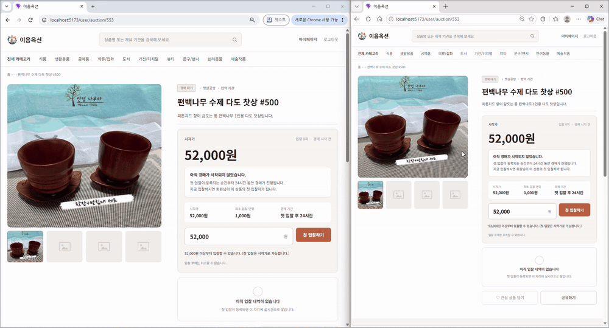
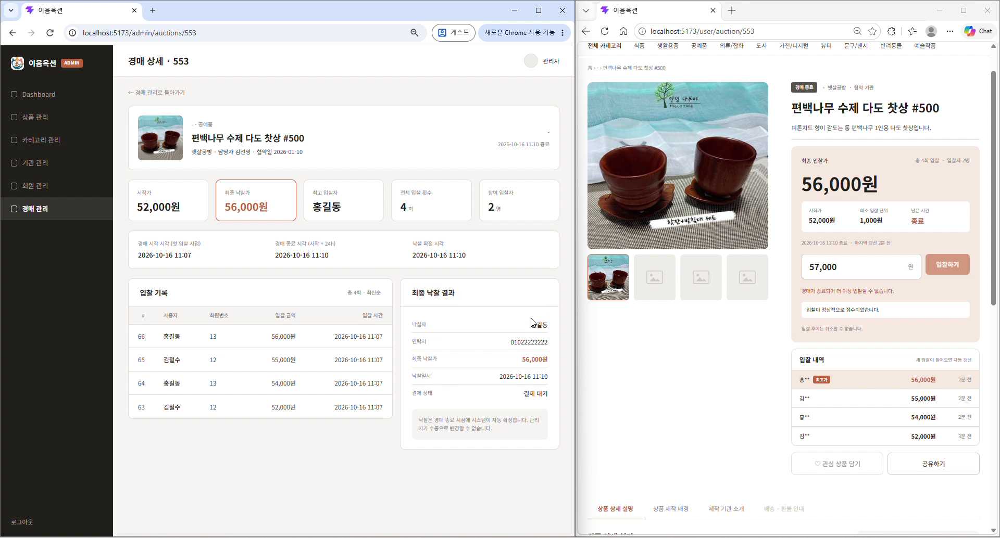
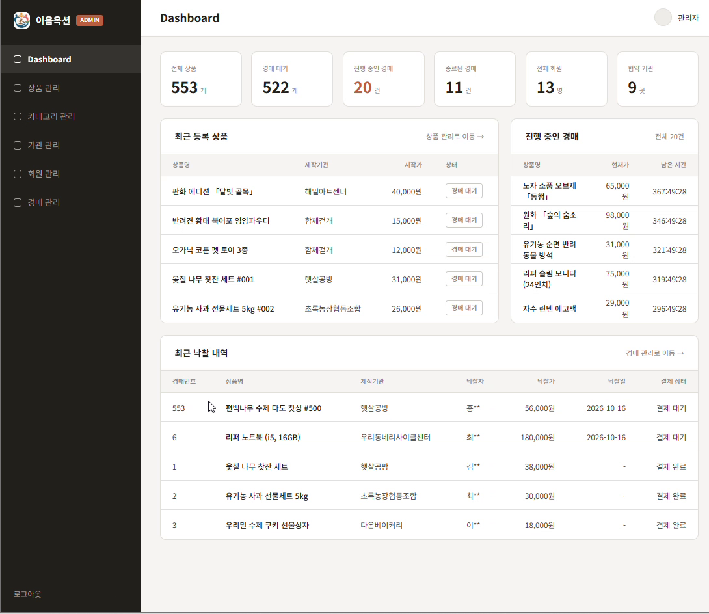
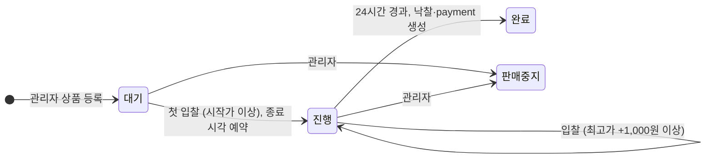
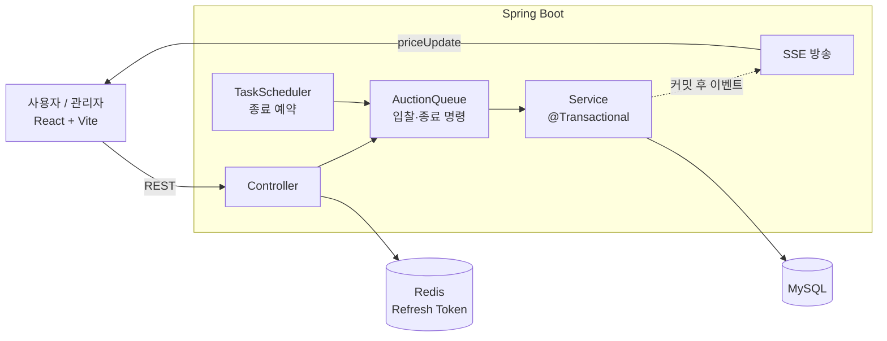
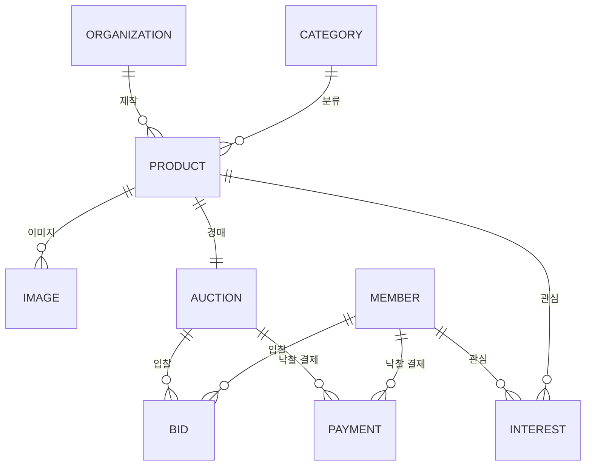

# 이음 옥션 (IEUM Auction)

> 당신의 입찰이 누군가의 내일이 됩니다.

사회적 약자와 취약계층이 직접 만든 상품을 협약 기관을 통해 엄선하고, **온라인 경매**로 판매하는 사회적 가치 플랫폼입니다.

- 기간: 2026.09.15 ~ 2026.10.16 (고급웹프로그래밍 5조 팀 프로젝트)
- 팀: 4명 (팀장 김두현)
- 스택: React · Spring Boot · MySQL · Redis · SSE


## 시연

**두 사용자가 같은 경매에 입찰하는 장면** — 한쪽에서 입찰하면 다른 쪽 화면의 현재가·입찰 내역·남은 시간이 SSE로 즉시 갱신됩니다.



**경매 종료** — 종료 시각이 되면 서버가 자동으로 낙찰자를 확정하고(왼쪽: 관리자 경매 상세), 사용자 화면은 `경매 종료`로 바뀌어 더 이상 입찰할 수 없습니다(오른쪽).



<details>
<summary>관리자 대시보드</summary>



</details>

## 기획 배경

상품을 만드는 것만으로 판매가 이루어지지는 않습니다. 소비자에게 상품을 알리고, 가치를 인정받고, 구매로 이어지는 과정이 필요합니다.
이음 옥션은 **"취약계층이 만든 상품이 더 많은 소비자와 만날 수 있다면 어떨까?"** 라는 질문에서 출발했습니다.

- **생산자에게는** 상품을 꾸준히 선보일 온라인 판매 창구를 제공합니다.
- **소비자에게는** 상품의 품질과 제작 배경, 판매 기관 정보를 살펴본 뒤 자신이 생각하는 가치를 가격으로 제안하는 참여형 구매 경험을 제공합니다.
- **운영자에게는** 상품 등록부터 입찰, 낙찰까지의 기록을 한곳에서 관리하는 운영 환경을 제공합니다.

**차별점** — 기존의 장애인·취약계층 생산품 판매처는 완성된 상품을 일반 쇼핑몰 형태로 판매하는 데 집중되어 있습니다. 이음 옥션은 생산시설·사회적 기업과 **협약 관계를 맺고**, 이들이 만든 상품을 **경매 콘텐츠**로 소개해 입찰이라는 행동으로 이용자의 관심과 참여를 끌어냅니다.

## 경매 규칙

일반적인 경매와 달리 **관리자가 경매 시작 시각을 정하지 않습니다.**

1. 상품은 관리자만 등록하며, 등록 직후 상태는 `대기`입니다.
2. 첫 입찰은 시작가 이상이면 가능하고, **첫 입찰이 들어온 순간부터 24시간** 카운트다운이 시작됩니다.
3. 이후 입찰은 현재 최고가보다 최소 1,000원 높아야 합니다.
4. 종료 시 최고 입찰자가 낙찰되고 결제(payment) 레코드가 생성됩니다.

**왜 첫 입찰부터인가?** 시작 시각을 미리 정하면, 아직 소비자에게 알려지지 않은 상품이 입찰 없이 마감될 수 있습니다. 누군가 입찰해 관심이 확인된 뒤에야 시간이 흐르게 해서, 입찰 없는 마감을 막았습니다.



> 시연을 위해 코드상 종료 시간은 첫 입찰 후 3분으로 설정되어 있습니다 (`UserAuctionService`). 위 시연 영상도 3분 설정으로 촬영했습니다.

## 주요 기능

| 사용자 | 관리자 |
| --- | --- |
| 메인: 추천·인기·신규·마감 임박 상품 | 대시보드: 상품·경매 상태별·회원·협약 기관 수, 최근 등록·최근 낙찰 |
| 상품 목록: 카테고리 필터, 검색 | 상품 관리: 등록·수정·판매 중지 |
| 경매 상세: 실시간 현재가·입찰 내역, 입찰 확인 모달 | 경매 관리: 입찰 기록, 최종 낙찰 결과 |
| 관심 기반 추천 (조회 기록 + 시간 감쇠) | 기관 관리: 협약서 파일 업로드, 협약 상태 |
| 회원가입 / 로그인 / 마이페이지 | 회원·카테고리 관리 |

## 시스템 구성



<details>
<summary>ERD (JPA 엔티티 기준)</summary>



</details>

## 기술적 고민과 해결

### 1. 동시 입찰에서 최고가가 꼬이는 문제
- **문제** 여러 사용자가 같은 경매에 동시에 입찰하면, 둘 다 같은 최고가를 기준으로 검증을 통과해 최고가와 입찰 기록이 어긋날 수 있다.
- **해결**
  - 입찰과 경매 종료 명령을 모두 `AuctionQueue`(크기 제한 `ArrayBlockingQueue`)에 넣고 워커 스레드가 처리한다. 큐가 가득 차면 `QueueFullException`으로 즉시 거절해 요청 폭주를 막는다.
  - 워커는 경매 ID별 `ReentrantLock`을 잡아 같은 경매의 명령을 한 건씩 처리하고, 다른 경매는 별도 락으로 동시에 처리한다.
  - 서비스에서는 경매 행을 `SELECT ... FOR UPDATE`로 잠근 뒤 최고가를 검증하고 저장해 DB 수준에서도 정합성을 지킨다.
- **결과** 같은 경매의 입찰은 들어온 순서대로 처리되고, 입찰과 종료가 겹쳐도 종료 이후의 입찰은 반영되지 않는다.

### 2. 롤백된 입찰이 화면에 보이는 문제
- **문제** 입찰 저장 중에 SSE를 보내면, 이후 트랜잭션이 롤백되어도 다른 사용자 화면에는 이미 바뀐 가격이 나간다.
- **해결** 입찰 성공 시 이벤트만 발행하고, `@TransactionalEventListener(AFTER_COMMIT)`에서 커밋이 끝난 뒤 현재가·입찰 수·최근 입찰 5건을 방송한다.

### 3. 서버 재시작 시 경매 종료가 사라지는 문제
- **문제** 종료 작업을 `TaskScheduler` 메모리에 예약하므로, 서버가 재시작되면 진행 중이던 경매가 영원히 끝나지 않는다.
- **해결** 기동 완료 이벤트(`ApplicationReadyEvent`)에서 `AuctionRecovery`가 진행 중인 경매를 조회해, 종료 시각이 지났으면 즉시 종료하고 남았으면 다시 예약한다.

### 4. 서비스 간 순환 참조
- **문제** 사용자 경매 서비스 → 스케줄러 → 큐 → 다시 사용자 경매 서비스로 의존이 돌면서 순환 참조가 생길 수 있었다.
- **해결** 경매 종료와 낙찰 처리를 `ClosingAuctionService`로 분리해 큐가 종료 서비스에만 의존하도록 했다.

### 5. 인증과 개인정보
- 로그인 시 Access Token(20분)과 Refresh Token(23시간)을 HttpOnly 쿠키로 내려주고, Refresh Token은 Redis에도 저장해 `/reissue`에서 대조한다.
- 입찰자 ID는 요청 본문이 아니라 검증된 토큰에서 꺼내 사용한다.
- 회원 아이디·이름은 AES 블록 암호를 직접 구현해 암호화했다(학습 목적, 단일 블록 방식이라 15바이트 이하만 지원). 비밀번호는 BCrypt로 해시한다.

## 기술 스택

| 영역 | 사용 기술 |
| --- | --- |
| Frontend | React 19, React Router 7, Vite 8 (React Compiler) |
| Backend | Java 17, Spring Boot 4.1, Spring Data JPA, Validation |
| 인증·보안 | JWT (HttpOnly 쿠키) + Redis, AES(직접 구현), BCrypt |
| 실시간 | SSE (Server-Sent Events) |
| DB | MySQL (`ieum`), Redis |

## 팀 구성과 운영

| 이름 | 담당 |
| --- | --- |
| 김두현 (팀장) | 프로젝트 총괄: 기능 범위·역할 분담, Jira 스프린트 운영, 데일리 스크럼, 기획서·Figma 와이어프레임·발표 자료 |
| 최윤성 | 상품 관리, 관심 기반 추천 |
| 서현욱 | 회원·인증(JWT/Redis), AES 암호화 |
| 안현준 | 경매·입찰 로직, 입찰 큐, SSE |

- **구현 순서**: 관리자가 상품을 등록해야 사용자 화면에 상품이 보이므로, 1차 관리자 → 2차 사용자 순으로 스프린트를 나눴습니다.
- **스프린트**: Jira로 3회 운영 (S1 09.28~10.06 · S2 10.07~10.11 · S3 10.12~10.15)
- **협업**: 팀원별 브랜치에서 개발한 뒤 `main`으로 취합

## 한계와 향후 과제

- PortOne PG 결제 미연동 (낙찰 시 결제 레코드만 생성)
- 경매 종료 시간을 시연용 3분에서 24시간으로 되돌리기
- 경매 종료 예약이 단일 서버 메모리에 있어, 서버를 여러 대로 늘리면 종료 작업 중복을 막을 장치가 필요
- 한 경매에 입찰이 몰리면 워커가 그 경매의 락을 기다려 다른 경매가 지연될 수 있음 (워커 수 조정 또는 경매별 전담 스레드로 개선 가능)
- AES를 표준 라이브러리(AES-GCM)로 교체하고 키를 분리

<details>
<summary>프로젝트 구조 · 실행 방법</summary>

```
backend/   Spring Boot (도메인별 패키지: auction, bid, products, member, organization, category, dashboard, payment, interest, global)
frontend/  React + Vite (pages/user, pages/admin)
docs/      README 이미지
```

사전 준비: JDK 17, Node.js, MySQL, Redis (Spring 기본 접속 설정 localhost:6379 사용)

```bash
# 1. DB 생성
#    application.properties의 접속 주소가 jdbc:mysql://localhost:3306/ieum 이므로 ieum 데이터베이스가 있어야 합니다.

# 2. backend/src/main/resources/application.properties 에서 DB 계정, jwt.secret, aes.secret 설정
#    (ddl-auto=create-drop, 기동 시 sql/sample.sql 샘플 데이터 적재)

# 3. 백엔드 (http://localhost:8080)
cd backend
./gradlew bootRun

# 4. 프론트엔드 (http://localhost:5173, /ieum·/api 등은 8080으로 프록시)
cd frontend
npm install
npm run dev
```

</details>
